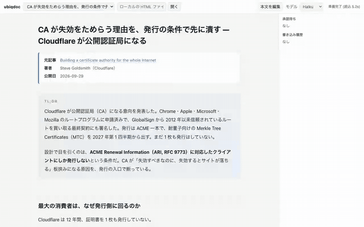
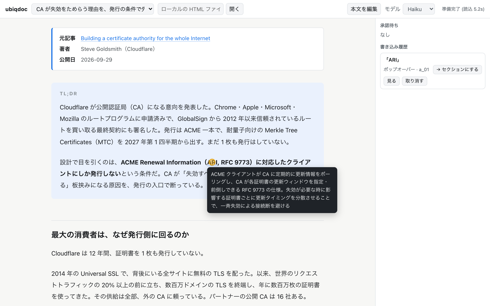
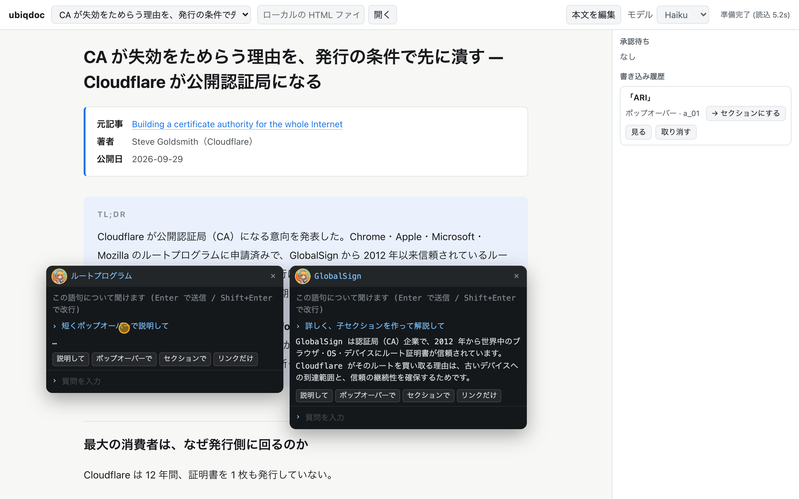
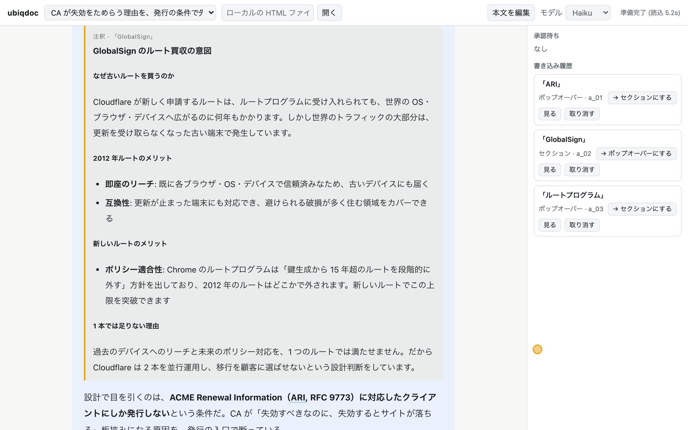
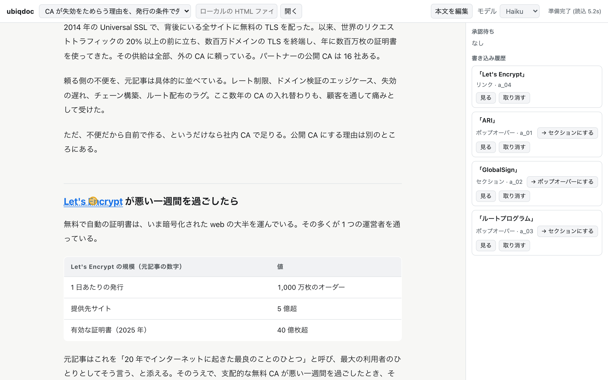

# ubiqdoc

ドキュメントを読んでいて、どの瞬間でもすぐ AI とチャットできるリーダー。

ローカルの HTML 文書をブラウザで開き、分からない語句をドラッグすると、その場に小さなチャット窓が開く。
答えはポップオーバー・子セクション・リンクのどれかの形で、**文書の本文に直接書き込まれる**。
前の答えを待たずに、次の語句をいくつでも並行して聞ける。

A local document reader where you can drag any phrase and ask an AI about it on the spot. Answers are written back into the document itself as popovers, child sections, or links, and you can ask about several phrases in parallel.



フル尺の動画 (70 秒、等速): [docs/demo.mp4](docs/demo.mp4)

## なぜ作ったか

ターミナルに移って質問を打ち、前の返答を待っているうちに、さっきまで何を読んでいたのかを忘れる。それを無くしたかった。

- 窓は選んだ語句のその場に開く。目線を別の窓に移さない
- 前の答えを待たない。答えを待っている間も、次の語句に聞ける
- 答えは読んでいた場所に入る。会話ログの中から探し直さなくていい

設計の経緯と試行錯誤は記事に書いた: [ドキュメントを読んでいて、どの瞬間でもすぐ AI とチャットできるリーダーを作った (Zenn)](https://zenn.dev/ruri/articles/ubiqdoc-ai-chat-reader)

## できること

| | |
|---|---|
|  | **ポップオーバー**: 短い説明。語句にホバーすると出る |
|  | **並列**: 答えを待っている間に、別の語句でも窓を開ける。新しい窓は待っている窓を避けて開く |
|  | **子セクション**: 長い説明。語句を含む段落の直後に、注釈とわかる枠付きで入る |
|  | **リンク**: 一次情報を示すだけで足りるとき |

- 書き込み方は窓のボタン (「ポップオーバーで」「セクションで」「リンクだけ」) で指定する。指定しなければ AI が選ぶ
- 右のペインで、質問 1 回分の取り消し、ポップオーバーとセクションの相互変換、AI からの本文書き換え提案の承認ができる
- 「本文を編集」で本文を直接直せる (自動保存)。編集を終えると、直した本文を AI が読み直す
- 書き込むのは元のファイルではなくコピー (`data/<docId>/doc.html`)。書き込み済みのコピーは単体で開いても注釈込みで読める

## 必要なもの

- Node.js 18 以上 (依存パッケージは無い)
- [Claude Code](https://docs.claude.com/en/docs/claude-code) の CLI (`claude`) にログイン済みであること。質問のたびに `claude -p` を起動する
- macOS + Chrome で動作確認している

## Chrome 拡張として使う

開いたページのうち、読み手が知らなそうな概念に、聞かれる前に補足 (出典付き) を付けておく拡張です。補足に「知ってる」を返すと、その概念は知識プロフィールに入り、以後どのページでも付きません。語句を選んで「AI に聞く」で、HTML リーダーと同じ小窓も使えます。

### 必要なもの

- Chrome 116 以上 (macOS で動作確認している)
- Node.js 18 以上
- [Claude Code](https://docs.claude.com/en/docs/claude-code) の CLI (`claude`) にログイン済みであること。拡張は `claude -p` で補足を作る

### インストール

1. このリポジトリを手元に置く

   ```bash
   git clone https://github.com/atsushiootani/ubiqdoc.git
   cd ubiqdoc
   ```

2. native host を Chrome に登録する

   ```bash
   bash host/install.sh
   ```

   `登録しました: …/NativeMessagingHosts/com.atsushiootani.ubiqdoc.json` と `拡張 ID: …` が出れば成功です。拡張から呼ばれたときだけ起動するので、常駐するプロセスはありません。

   Chrome が起動するプロセスにはログインシェルの `PATH` が渡らないので、このスクリプトは実行した時点の `node` と `claude` の絶対パスを焼き込んだラッパ (`host/run.sh`) を作ります。`node` や `claude` を入れ直して場所が変わったら、もう一度実行してください。

3. 拡張を読み込む

   1. `chrome://extensions` を開き、右上の「デベロッパーモード」を ON にする
   2. 「パッケージ化されていない拡張機能を読み込む」で、このリポジトリの `extension/` を選ぶ
   3. 一覧に出た ID が、手順 2 で出た「拡張 ID」と同じことを確かめる (manifest の `key` で固定しているので、どの環境でも同じになる)

4. オプション画面で確かめる (初回は自動で開く。あとから開くときは、拡張の「詳細」→「拡張機能のオプション」)

   - 「native host」が「つながっています」になっていること。エラーが出ていたら、その文に従う (下の「うまく動かないとき」も参照)
   - サイトごとの設定の各行で「許可する」を押す。許可したサイトでは、ページを開いただけで「AI に聞く」が使えます (補足は自動では作りません)。最初から入っているのは次のとおりです

     | パターン | サイト |
     |---|---|
     | `https://www.notion.so/*` | Notion |
     | `https://app.notion.com/*` | Notion |
     | `https://*.notion.site/*` | 公開された Notion ページ |
     | `https://github.com/*` | GitHub |

   - ほかのサイトを足すときは、パターン (例: `https://example.com/*`) と、補足を付ける範囲の CSS セレクタ (本文の根。サイドバーなどを除くため。省略すると `main`) を入れて「追加」する

5. ローカルの HTML ファイル (`file://`) でも使うなら、拡張の「詳細」で「ファイルの URL へのアクセスを許可する」を ON にする

### 使い方

- **ツールバーの ubiqdoc ボタン**: サイドパネルが開き、そのページで語句の「AI に聞く」が使えるようになります。設定で許可したサイトなら、ボタンを押さなくても開いただけで使えます
- **先回りの補足**: サイドパネルの「補足を付ける」を押したときだけ作ります。初回は数十秒かかり、ツールバーのバッジに `3/20` のように進み具合が出ます。作った補足は保存され、次にページを開いたときはすぐに出ます。作り直すときは「補足を作り直す」
- **記事を iframe で表示するページ** (自作のダッシュボードなど) でも使えます。語句の選択は iframe の中でも拾い、先回りの補足は本文がいちばん多いフレームに付けます
- 下線の付いた語句にマウスを乗せると説明が出ます。セクションの補足は語句をクリックするとカードで開きます
- 知っている概念なら「知ってる」を押します。画面下のトーストの「戻す」で取り消せます。あとからでも、サイドパネルの「プロフィール」タブから戻せます
- 語句を選ぶと「AI に聞く」ボタンが出ます。小窓で質問すると、答えが補足として足されます
- サイドパネル (ツールバーのボタンで開く) で、書き込み履歴の取り消し、ポップオーバーとセクションの変換、承認待ちの処理ができます

### 更新

```bash
git pull
```

そのあと `chrome://extensions` で ubiqdoc の再読み込みボタンを押します。`host/` を変えた更新でも、host は呼ばれるたびに起動し直すので、追加の作業はいりません (`node` の版を消したときも、host は起動のたびにシェルへ聞き直すので、そのまま動きます)。

サイトごとの設定に行が増えた更新では、オプション画面で新しい行の「許可する」を押してください。設定を自分で編集したことがあると、新しい既定の行は自動では入らないので、手で「追加」してください。

### うまく動かないとき

| 症状 | 対処 |
|---|---|
| オプション画面やサイドパネルに「host が未登録です」と出る | リポジトリで `bash host/install.sh` を実行し、拡張を再読み込みする |
| 「host が起動できませんでした」と出る | `node` か `claude` が見つからない。理由は `logs/host-launch.log` に出ている。リポジトリで `bash host/install.sh` を実行し直し、拡張を再読み込みする |
| 語句を選んでも「AI に聞く」が出ない | そのページにまだ差し込まれていない。ツールバーの ubiqdoc ボタンを押す (ページを再読み込みしたら押し直す)。毎回押したくないサイトは、オプション画面で URL に合うパターンを足して許可する (Notion は URL が `www.notion.so` と `app.notion.com` の 2 通りある) |
| バッジに `!` が出る | サイドパネルにエラーの 1 行が出ている。`claude` が未ログインなら、ターミナルで `claude` を起動してログインしてから「補足を作り直す」 |
| 「git の無視対象になっていません」と出て動かない | `data/` が `.gitignore` から外れている。下の「知識プロフィール」を参照 |

### 知識プロフィールとデータ

- 知識プロフィールは `data/profile/personal.json` (技術) と `data/profile/work.json` (業務) にあります。ページごとの補足は `data/ext/pages/` です
- **`data/` はコミットされません**。業務の知識やページの本文が入るので、host は起動のたびに、`data/` が git の無視対象であることと、過去にコミットされていないことを確かめます。外れていたら起動しません
- 1 ページあたりの先回りの補足は 20 個までです。出典の付けられない補足は出しません
- 補足はページの DOM を書き換えずに重ねて描くので、Notion で編集しても補足が本文に混ざりません

### アンインストール

1. `chrome://extensions` で ubiqdoc を削除する
2. 登録ファイルを消す: `~/Library/Application Support/Google/Chrome/NativeMessagingHosts/com.atsushiootani.ubiqdoc.json`
3. 知識プロフィールと補足が要らなければ、リポジトリの `data/ext/` と `data/profile/` を消す

### E2E テスト

```bash
cd e2e && npm install && npx playwright-core install chromium && npm run e2e
```

偽の `claude` で動きます。Playwright 同梱の Chromium と使い捨てのプロファイルを使うので、本物の Chrome のプロファイルには触りません。

## Claude Code のプラグインとして入れる

```bash
claude plugin marketplace add atsushiootani/concier-chan-kit
claude plugin install ubiqdoc@atsushiootani
```

セッションで `/ubiqdoc:open /abs/path/to/doc.html` と打つと、サーバを立ち上げて文書をブラウザで開く。
既定ではコピーに書き込み、元のファイルには触らない (元ファイルに書きたいときはそう頼む)。コピーはプラグインのデータフォルダに残る (プラグインを更新しても消えない)。

## 使い方 (リポジトリから直接動かす)

```bash
git clone https://github.com/atsushiootani/ubiqdoc.git
cd ubiqdoc
node server.js                     # http://127.0.0.1:8910/
UBIQDOC_PORT=9000 node server.js   # ポートを変えるとき
```

| 環境変数 | 既定 | 何を変えるか |
|---|---|---|
| `UBIQDOC_PORT` | `8910` | 待ち受けポート。`PORT` より優先する |
| `PORT` | — | 後方互換。ほかのツールと一緒に起動すると**この値が漏れてくる**ので、そのときは `UBIQDOC_PORT` を使う |
| `UBIQDOC_DATA_DIR` | `./data` | 開いた文書と会話ログの置き場 |

1. 上のバーに HTML ファイルの絶対パスを入れて「開く」。裏で AI が文書を読み込み、右上が「準備完了」になる
2. 語句をドラッグして、窓で質問する (Enter で送信 / Shift+Enter で改行)
3. 文書の背景をクリックすると窓が閉じる。閉じても、返答待ちだった答えは文書に書き込まれる

モデルは右上で Haiku / Sonnet / Opus から選べる (既定は Haiku)。

### 元のファイルに直接書き込む

既定では、書き込み先は元のファイルではなくコピー (`data/<docId>/doc.html`) になる。
**「元ファイルに書く」にチェックを入れると、開いたファイルそのものに注釈が入る。**
読んでいる文書を育てたいとき（自分のメモ・設計書・調査ノート）はこちら。

- 取り消しは今までどおり効く。質問 1 回ぶんの直前の状態は `data/<docId>/history/` に残る
- **git などで戻せるファイルで使うことを勧める。** 控えは history だけなので、そこを消すと戻せない

### 外のツールから開く

`?open=<絶対パス>` を付けて開くと、そのファイルをそのまま開く。
エディタ・ファイラ・自作のダッシュボードから、リンク 1 本で送れる。

```
http://127.0.0.1:8910/?open=/Users/me/notes/design.html          # 元ファイルに書く
http://127.0.0.1:8910/?open=/Users/me/notes/design.html&inPlace=0 # コピーに書く
```

同じファイルを開き直したときは、前の文書をそのまま開いて「既に開いています」と知らせる
（新しく作り直したいときは `/api/open` に `fresh: true` を渡す）。
開いたあとに元ファイルが外で書き換わったら、上に帯が出る。
**読み直しは自動では走らない** —— 帯の「読み直させる」を押したときだけ `claude` を焚く。

## しくみ

- 文書を開いた時点で、全文を読ませただけの**ベースセッション**を 1 本作る。窓で最初に質問したときは `claude -p --resume <base> --fork-session` で複製して答えさせる。同じ窓の 2 回目以降はその枝を続ける。毎回文書を読み直さないので速く、枝同士は互いの会話を知らないので並列にしても混ざらない
- 実測 (Haiku、約 17KB の記事): fork 単体 4.5〜6.3 秒 (3 本並列でも同じ)、ポップオーバー 6.6〜8.2 秒、子セクション 11〜15 秒
- 書き込みはブラウザ側で 1 件ずつ反映する。JavaScript は単一スレッドなので、届いた順 = 先着優先になる
- claude のセッションは `~/.cache/ubiqdoc` を作業ディレクトリにして作る (resume に同じ cwd が要るため)

## 注意

- **手元の Mac でだけ使う想定**。サーバは `127.0.0.1` にだけ bind し、Host が `127.0.0.1:<PORT>` / `localhost:<PORT>` 以外のリクエストと、他サイトからの書き込み要求を断る。リクエストを受けて `claude` を起動するサーバなので、外部に公開しないこと
- 入力は HTML だけ。文書の中の script は動かさない (mermaid などの図はコードのまま見える)
- 子セクションの答えは 10 秒を超えることがある
- AI が、選んだ語句より広い範囲に注釈を付けることがある。既にある注釈と重なった書き込みは「承認待ち」に回る
- 個人用ツールとして作ったもので、サポートは約束できない

## ライセンス

- コード: [MIT](LICENSE)
- マスコット画像 (`public/avatar-smile.jpg` `public/avatar-thinking.jpg`): CC0。自由に使ってよい
